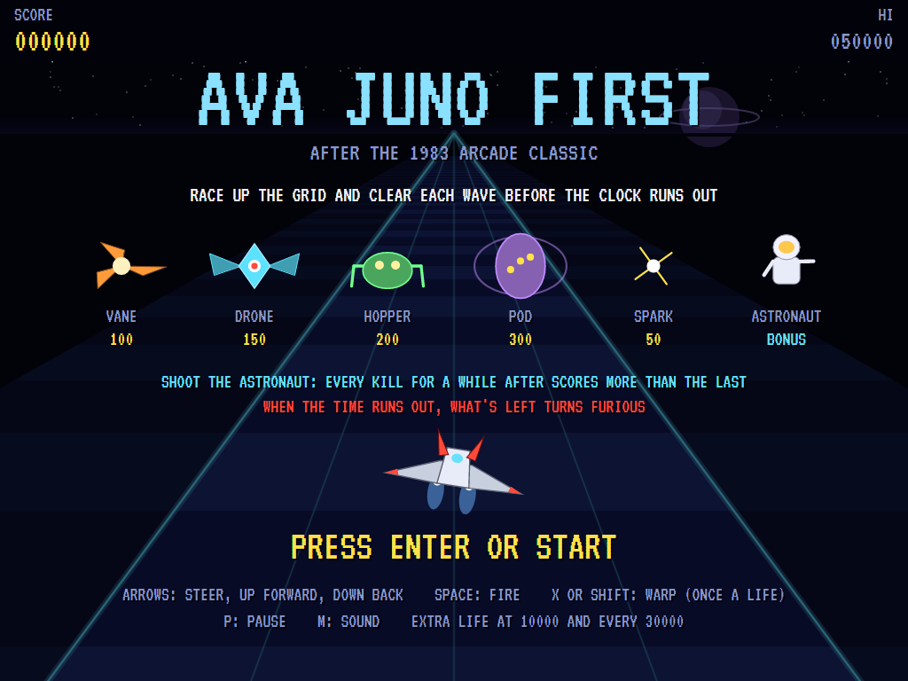
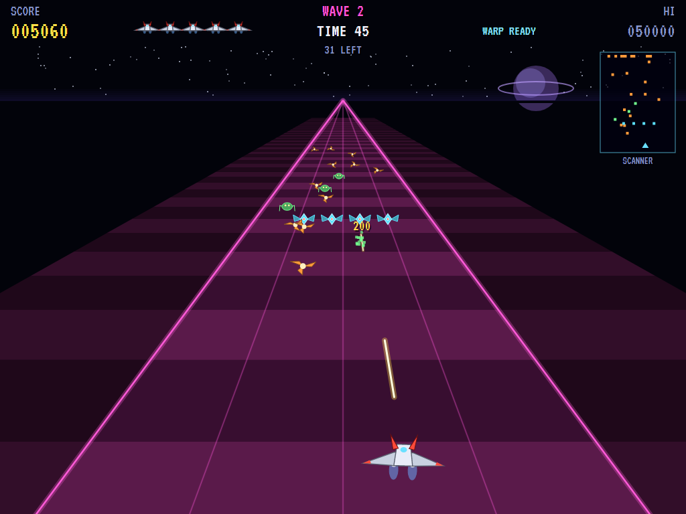
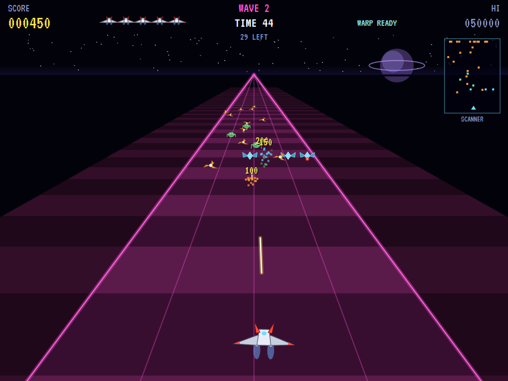
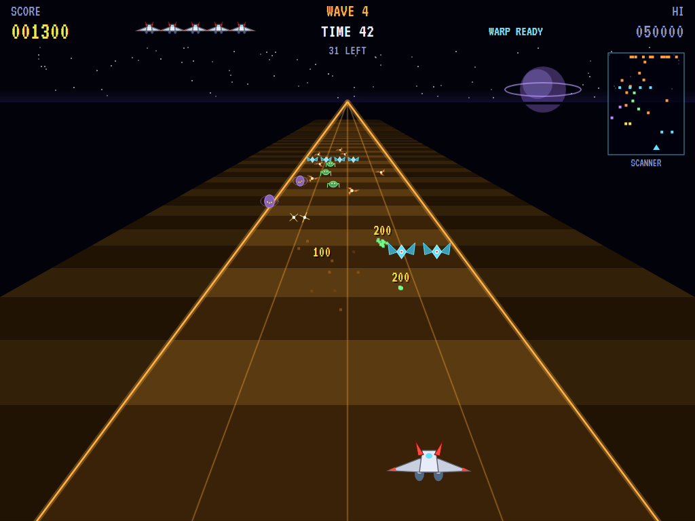
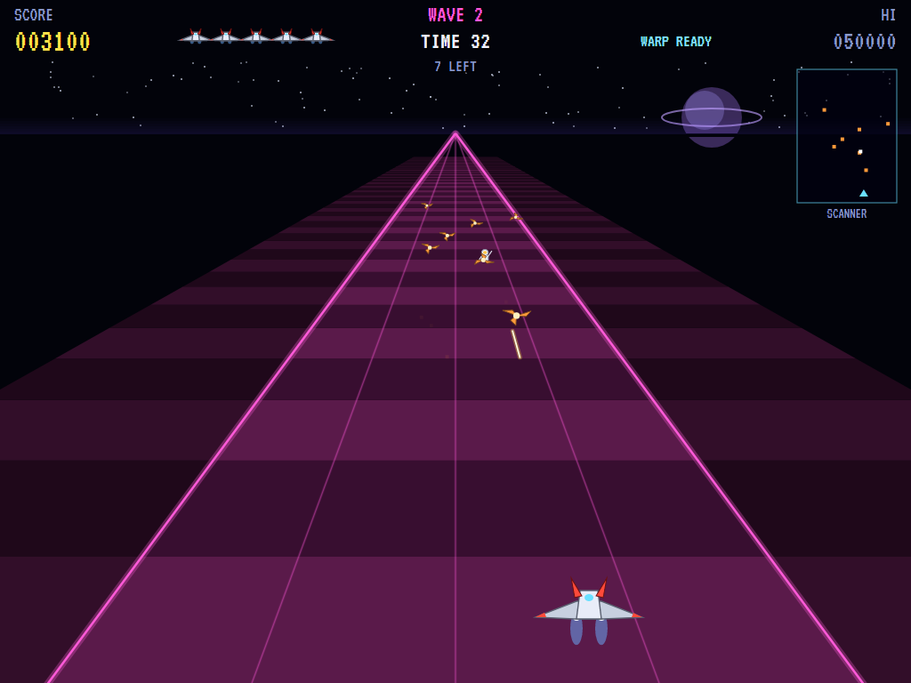
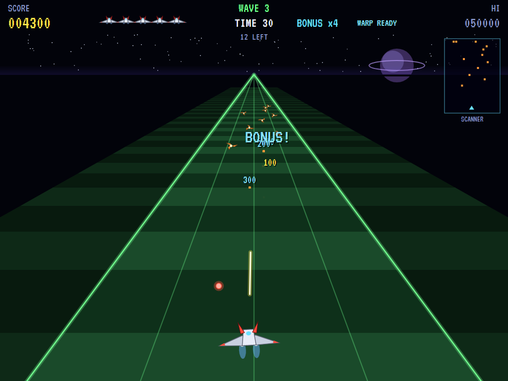
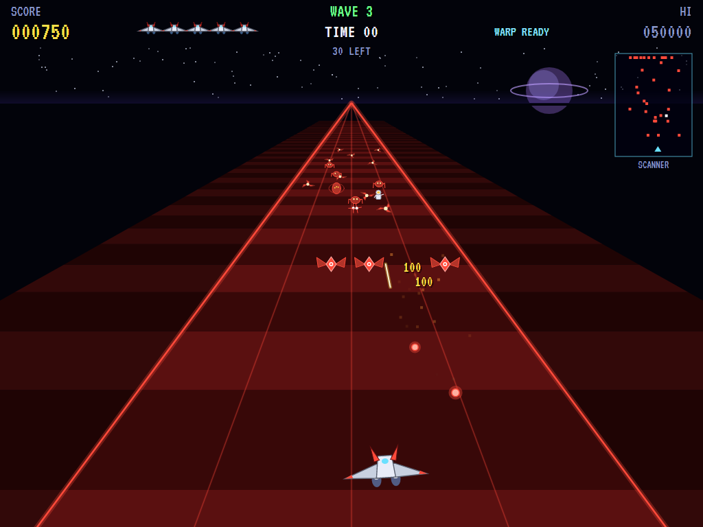
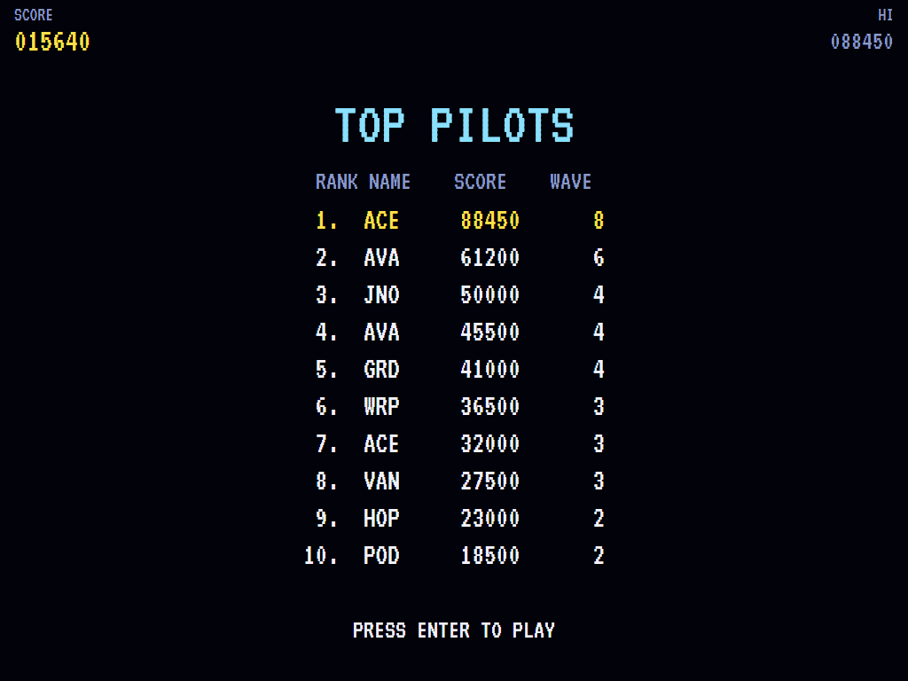

# AVA Juno First

[](https://github.com/Harlock123/AVAJunoFirst/actions/workflows/build.yml)

A grid shooter in the style of Konami's 1983 arcade game **Juno First**, built with .NET 10 and Avalonia UI.
Your ship flies over a banded grid that runs away to the horizon. Push forward and the grid races towards you;
pull back and you retreat. The enemy hovers at its places up the grid, dives, leaps and fires, and your shots
reach only so far. To clear a wave you have to go in after them, and before the clock runs out. Shoot the
astronaut for a bonus streak, and keep your one warp for when nothing else will save you.

## Features

- **The grid**: bands in the wave's colours running towards you as you go forward, the track's lines
  converging on a horizon with a ringed planet low in the sky.
- **The ship**: steer across the track, run forward or back, and fire up the grid. The shots reach only part
  of the way, so the enemy has to be closed on.
- **The enemy**, each kind with its own way of fighting:
  - **Vanes** (100) hover at their places on the grid, weaving, and every so often dive across at the ship,
    then pull back to come again.
  - **Drones** (150), from the second wave, hold formation up the grid, creeping down it, sliding to and fro
    and firing.
  - **Hoppers** (200), from the second wave, sit, then leap forward and across at the ship.
  - **Pods** (300), from the third wave, hang back, take two hits, and let loose sparks (50) that go for the
    ship.
  - Anything that gets behind you comes round again from far up the grid.
- **The astronaut**: floats in during each wave. Shoot it (500) and for a while every kill scores one more
  times as much as the last, up to eight.
- **The clock**: each wave has 45 seconds. Clear it in time for a bonus of 20 a second left. Run out, and
  everything still there turns red and furious, diving more often and closing in.
- **The warp**: once a life, a jump to the other side of the track that throws everything close by back up
  the grid.
- **The scanner** shows the track from above, and everything on it for 45 ahead.
- **Extra lives** at 10000 and every 30000.
- **The attract mode** plays itself: a computer player that leads its targets, backs off what's too close,
  sidesteps shots, and runs forward to find the enemy.
- **The sounds** are all synthesised: the shot's zip, the warp's sweep, the time-up alarm, the engine's hum
  and the title theme.

## Screenshots

| The title | Vanes | Drones |
|:---------:|:-----:|:------:|
|  |  |  |
| The enemy, and the rules. | Going in after them. | A formation, firing. |

| Pods and sparks | The astronaut | The bonus |
|:---------------:|:-------------:|:---------:|
|  |  |  |
| Sparks coming for the ship. | In sight: shoot it. | Each kill worth more. |

| Fury | The high scores | |
|:----:|:---------------:|:-:|
|  |  | |
| Time up: they come. | The top pilots. | |

The screenshots are made by the tests, which play the game in a real (headless) window; see
[Tests](#tests).

## Download and run

Ready-to-run builds for Windows, macOS and Linux, on both Intel/AMD and ARM, are on the
[Releases page](https://github.com/Harlock123/AVAJunoFirst/releases/tag/latest). **Latest build** is
rebuilt on every push to `main`. Each download is one self-contained executable: no .NET install is
needed.

| Platform | Archive |
|---|---|
| Windows | `AVAJunoFirst-win-x64.zip`, `AVAJunoFirst-win-x86.zip`, `AVAJunoFirst-win-arm64.zip` |
| macOS | `AVAJunoFirst-osx-arm64.tar.gz` (Apple silicon), `AVAJunoFirst-osx-x64.tar.gz` (Intel) |
| Linux | `AVAJunoFirst-linux-x64.tar.gz`, `AVAJunoFirst-linux-arm64.tar.gz`, `AVAJunoFirst-linux-arm.tar.gz` |

```bash
tar -xzf AVAJunoFirst-linux-x64.tar.gz     # or linux-arm64, linux-arm, osx-arm64, osx-x64
./AVAJunoFirst
```

On Windows, unzip and run `AVAJunoFirst.exe`. On macOS, if Gatekeeper refuses to open it, run
`xattr -d com.apple.quarantine AVAJunoFirst` once. Run with `--no-audio` for silence.

**Sound** comes through OpenAL Soft, built in for every platform. In a virtual machine the game
detects it and uses a larger audio buffer, so the sound doesn't break up.

**Gamepads** use SDL2, which is bundled for Windows, macOS and Intel/AMD Linux. ARM Linux builds need it
installed; without it the keyboard still works:

```bash
sudo apt install libsdl2-dev            # Debian / Ubuntu / Raspberry Pi OS
sudo pacman -S --needed sdl2-compat     # Arch / Omarchy
```

## Controls

| Input | Action |
|-------|--------|
| **Enter** | Start |
| **Arrow keys** / **W A S D** | Walk (diagonals too) |
| **Space** / **Z** / **X** / **Ctrl** | Shoot an arrow, the way you last walked (in a room) |
| **P** / **Esc** | Pause (Esc again to quit) |
| **M** | Mute |
| **Ctrl+S** / **Cmd+S** | Save a screenshot to the Pictures folder |

**Gamepad**: left stick or D-pad to walk, **A**, **B**, **X** or the right trigger to shoot, **Start** to
start and pause, **Back** (while paused) to quit.

**Entering initials**: type letters, or dial with **Up**/**Down** and accept with **Space**; **Left** /
**Backspace** go back; **Enter** finishes.

## Controls

| Action | Keyboard | Gamepad |
|---|---|---|
| Steer | Left / Right (or A / D) | Left stick / D-pad |
| Forward / back | Up / Down (or W / S) | Left stick / D-pad |
| Fire | Space, Z or Ctrl | A or right trigger |
| Warp (once a life) | X or Shift | B or X |
| Start | Enter | Start |
| Pause | P or Esc | Start |
| Sound on/off | M | |
| Screenshot | Ctrl+S (to your Pictures folder) | |

On the high-score table, type your initials, or use up/down and Space, then Enter.

## Tests

```bash
dotnet test AVAJunoFirst.slnx
```

The engine has no UI and runs in fixed 60 Hz steps, so it plays the same at any frame rate, and a seed
always plays the same game. The tests check:

- **The grid and the ship:** the perspective, steering and its limits, and going forward and back moving everything on the grid
- **Shooting:**
  - shots reaching only so far, and so many at once
  - hits in line (and misses out of it)
  - pods taking two
- **The enemy:**
  - vanes diving and pulling back
  - drones holding their place
  - pods' sparks
  - shots and collisions ending a life
  - coming back with the enemy pushed back
  - enemies that get behind coming round again
- **The astronaut, the warp and the clock:**
  - the bonus streak and its end
  - the warp, once
  - fury when time runs out
  - the time bonus, bigger waves, and extra lives
- **The machine:** the attract cycle, the computer player clearing the first wave, the same game from the same seed, and pausing

The screenshot tests draw the real screen in a headless window. To refresh the README's pictures:

```bash
JUNO_SHOTS=$PWD/Images dotnet test tests/AVAJunoFirst.Tests --filter ScreenshotTests
```

To see how the computer player gets on, wave by wave (for tuning):

```bash
JUNO_PROBE=1 dotnet test tests/AVAJunoFirst.Tests --filter PilotProbe --logger "console;verbosity=detailed"
```

## Building

```bash
dotnet build AVAJunoFirst.slnx
dotnet run --project src/AVAJunoFirst
```

Needs the .NET 10 SDK. The sounds are made by `tools/make_sounds.py` (standard-library Python):
`python3 tools/make_sounds.py` rewrites `src/AVAJunoFirst/Sounds`.

## Project structure

```
AVAJunoFirst/
├── AVAJunoFirst.slnx
├── src/AVAJunoFirst/
│   ├── Engine/
│   │   ├── GameEngine.cs        # States, the title and demo cycle, and the engine's hum
│   │   ├── GameEngine.Play.cs   # The ship on the grid, its shots and the warp; the enemy, the astronaut's
│   │   │                        # bonus, the clock and its fury; waves and scoring
│   │   ├── ShipPilot.cs         # The computer player, for the demonstration (and the tests)
│   │   ├── Entities.cs          # The perspective, the ship, the enemy and their shots
│   │   ├── HighScoreTable.cs, InitialsEntry.cs
│   │   ├── InputHandler.cs, ControllerManager.cs  # Keys and an SDL2 gamepad
│   │   └── SoundManager.cs      # Effects and the tunes through OpenAL
│   ├── Audio/                   # The OpenAL engine (from the author's AVABand)
│   ├── Views/                   # The grid, the ship, the enemy, the scanner and the screens
│   └── Sounds/                  # The synthesised effects and tunes
├── tests/AVAJunoFirst.Tests/    # Gameplay, screenshot and probe tests
├── tools/make_sounds.py
└── Images/                      # Screenshots
```

## About and licence

AVA Juno First © 2026 Lonnie Watson, under the [MIT License](LICENSE).

*Juno First* © 1983 Konami; the name belongs to its current owner. AVA Juno First is an independent,
unofficial game in its style. Its ship, its vanes, drones, hoppers, pods and astronaut, its graphics, sounds,
tunes and code are its own; nothing is taken from the arcade machine's program, graphics, sound or music. It
is not affiliated with or endorsed by any rights holder.
